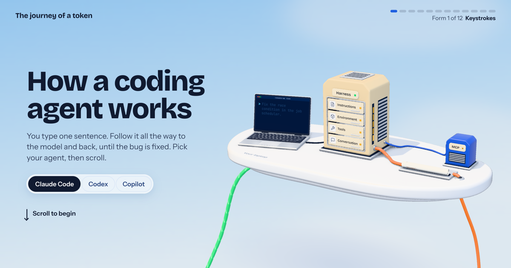

# The journey of a token

By Neo Mohsenvand. **[See it live →](https://neovand.github.io/Journey/)**

[](https://neovand.github.io/Journey/)

You type one sentence into a coding agent: *Fix the race condition in the job scheduler.* This site follows that sentence, as one scroll-driven 3D journey, through Claude Code, Codex or GitHub Copilot: into a JSON request, across the wire, through the transformer one token at a time, back through the permission gates, and around the loop until the tests pass.

Pick your agent at the top, and anywhere it behaves differently, the page changes with it.

## Running it

```sh
pnpm install
pnpm dev
```

Every push to `main` builds and publishes the site with GitHub Actions.

## How it's built

SvelteKit with the static adapter, and Three.js for one continuous scene. Every frame is a pure function of the scroll position, which a playhead turns into a bounded-speed clock, so a fast trackpad flick can't skip a beat.

`scripts/` holds the review tools used to build it:

| Script | What it does |
| --- | --- |
| `shots.mjs` | Exact frames at chosen moments, on any viewport and for any agent |
| `strip.mjs` | A dense contact sheet of one stretch of animation |
| `seams.mjs` | Every boundary between sections |
| `look.mjs` | A free camera, for close inspection with the cards hidden |
| `collide.mjs` | Scans the whole timeline for moving things passing through solid ones |
| `cards.mjs` | Checks that every card fits on screen, on every viewport and for every agent |
| `perf.mjs`, `flick.mjs`, `gpu.mjs` | Frame times, real wheel events, and GPU cost |

## Accuracy

The content follows the book in `reference/`. Harness details come from public docs and source as of November 2026. Inside the data center it follows public engines and papers, because providers don't publish their own. Numbers marked illustrative are just that.

## Licence

MIT, in [`LICENSE`](LICENSE), © 2026 Neo Mohsenvand: the code, the words, the book in `reference/`, the narration
and the sounds. The two typefaces in `static/fonts/`, Bricolage Grotesque and Instrument Sans, are their authors' work
under the SIL Open Font License 1.1. The model's brain in `static/models/brain.glb` is the left hemisphere of a real
MRI from the UCSF Neuroscape lab's Glass Brain project ([NIH 3D, 3DPX-000757](https://3d.nih.gov/entries/3dpx-000757)),
which they released into the public domain (CC0 1.0); it was smoothed, thinned and mirrored here, with a brainstem added.
Stars, issues and pull requests are all welcome.
